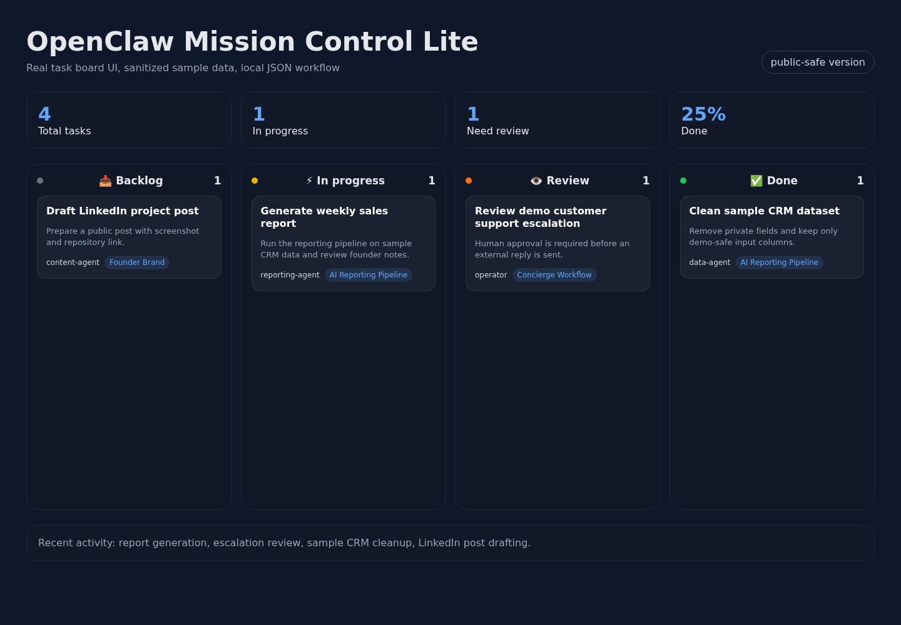

# OpenClaw Mission Control Lite

A sanitized public version of a real OpenClaw Mission Control dashboard.

The private version is used as an operator dashboard for coordinating AI-assisted workflows: tasks, project context, agent ownership, status changes, activity feed, and human approval checkpoints.

This repository keeps the real Next.js UI structure and local JSON workflow, but removes private production data, credentials, internal memory, Telegram routing, and live OpenClaw gateway calls.

## Screenshot



## What remains from the real project

- Next.js app structure
- Kanban task board
- project filters
- assignee filters
- local task/project APIs
- activity feed
- task claim/complete endpoints
- ping flow, rewritten to log locally instead of messaging real agents
- sample data shaped like the production app expects

## What was removed or replaced

- production task data
- private agent names and avatars
- Telegram/Gateway calls
- token/system routes
- memory/docs/system pages
- `.env.local`, `.next`, `node_modules`, build artifacts
- hardcoded production host paths

## Quick start

Requires Node.js 24.19.x and npm 11.17.x.

```bash
npm ci
npm run dev
```

Open:

```text
http://127.0.0.1:3000/tasks
```

The app reads sample JSON from `data/` by default.

To use your own folder:

```bash
MISSION_CONTROL_DATA_DIR=/path/to/your/data npm run dev
```

Expected files:

```text
data/tasks.json
data/projects.json
data/activity.jsonl
```

The development and production scripts bind to `127.0.0.1`. The write APIs
have no user authentication because this is a local synthetic demo. Do not
publish the server directly; add an explicit authentication and storage
boundary before any real deployment.

Run the complete local verification gate with:

```bash
npm run verify
```

It lints, checks dependency advisories, builds the production app and runs an
isolated API smoke against a temporary copy of the sample data. The smoke never
sends a message to an agent or changes the tracked JSON files.

## Why this exists

AI agent workflows become messy fast. A chat transcript is not enough to manage real operations.

Mission Control is the operating layer:

- what is being worked on
- who owns it
- what is blocked
- what needs human approval
- what changed recently

This lite version is intentionally local-first and safe to inspect.

## License

MIT
